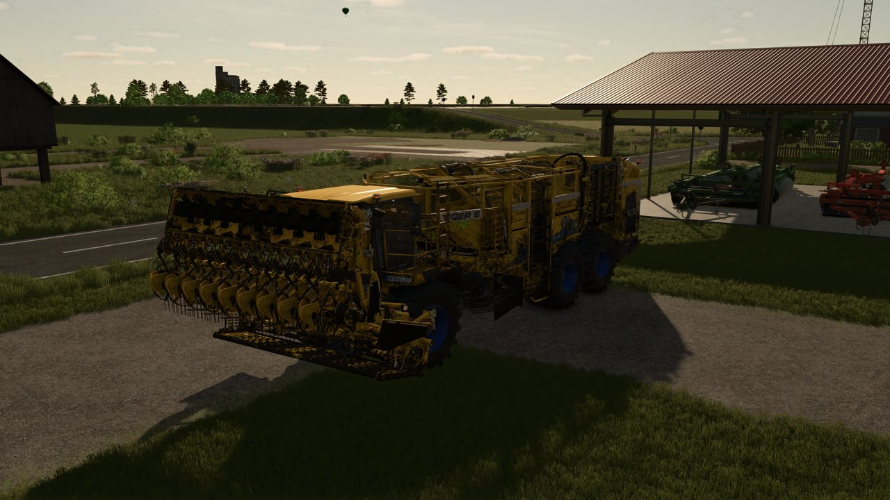
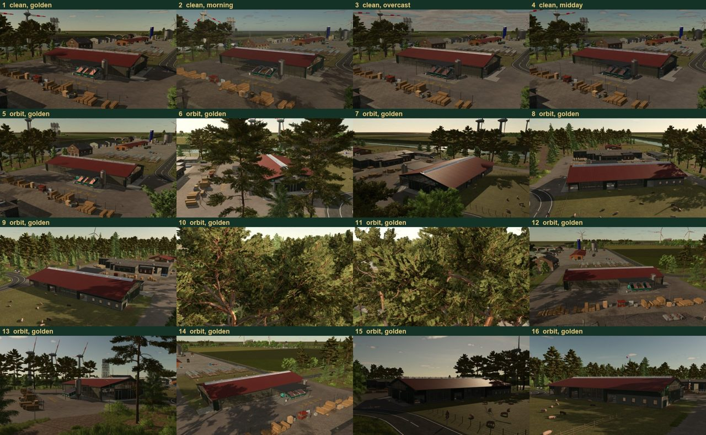
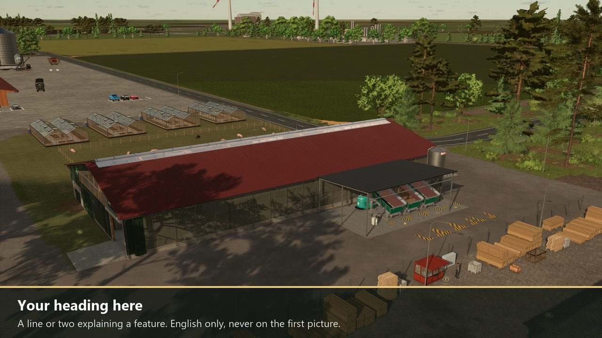
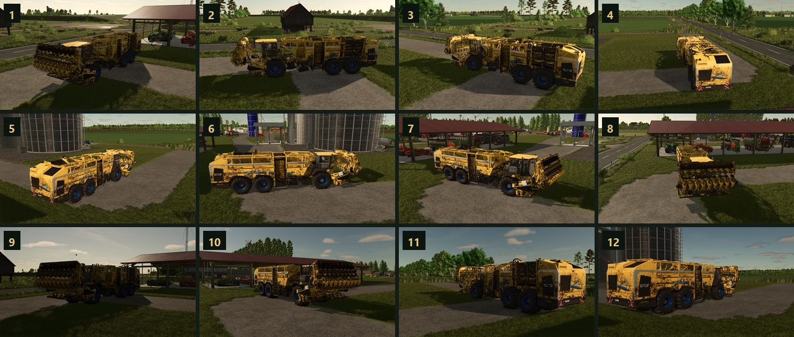
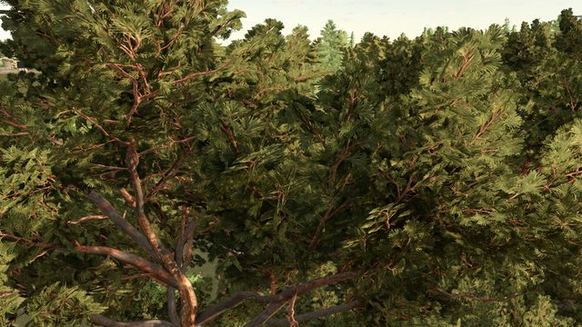
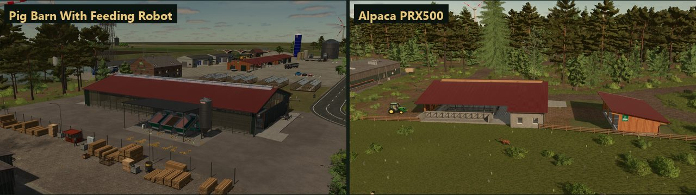
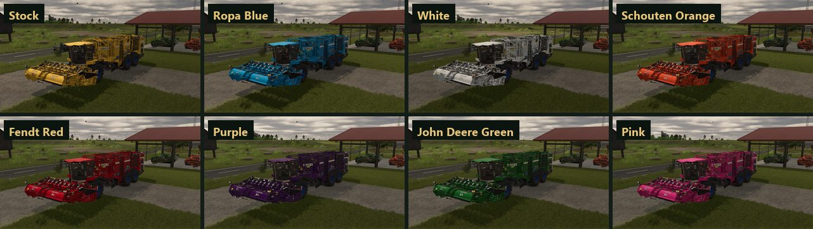
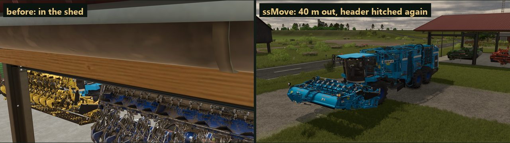
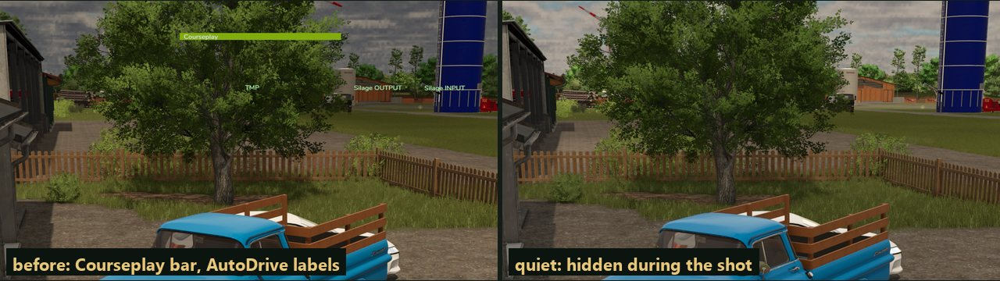
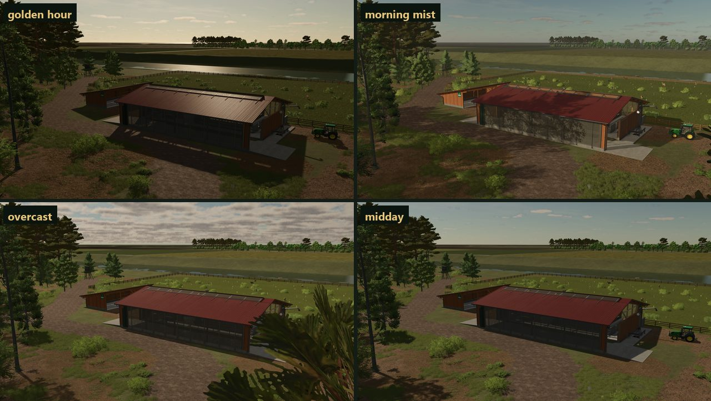

# DTM Screenshot Studio

A tool for modders: the game takes the screenshots of your mod for the GIANTS ModHub and dtmmods.com. **Single player only** (the mod switches itself off in multiplayer), and it never goes on the server or the ModHub.


*Taken by the mod on its own: the Tiger with its header moved out of a shed, golden hour, the whole machine framed. All pictures in this README are untouched game pictures (sizes reduced), from runs on 2026-11-13.*

| Key | What it does |
|-----|--------------|
| **Right Ctrl + 1** | **Clean shot**: the current view without HUD |
| **Right Ctrl + 2** | **Orbit**: 12 shots from all around the vehicle you sit in (with everything attached), or the nearest building when you're on foot: 8 in a ring, 4 low three-quarter "hero" views |
| **Right Ctrl + 3** | **UI shot**: waits 5 seconds (open the menu meanwhile), then saves the screen with the menu |
| **Right Ctrl + 4** | **Light**: golden hour (18:30, sun), morning mist (07:15, ground fog), midday sun (12:30), overcast (13:00, soft light); one more press brings the old time back (same day, so crops don't grow; the weather stays) |
| **Right Ctrl + 5** | **Burst**: a clean shot of the current view every 3 seconds for a minute while you drive into work; press again to stop. With the render method the HUD stays up for driving (the pictures leave it out anyway) |
| **Right Ctrl + 6** | **Every color**: the vehicle you photograph (on foot: the nearest vehicle) once in each shop color, from the same framed view (see "Framing") |

### What gets photographed

| | Orbit | Every color | Clean shot, burst |
|-|-------|-------------|-------------------|
| sitting in a vehicle | the vehicle with everything attached | the attached implement from a mod, else the vehicle | your view |
| on foot | the nearest building (150 m, mods first) | the nearest vehicle (40 m, mods first) | your view |
| `ssTarget <name>` | the target (with what it hangs on), wherever it stands | the target | your view if you sit in the target; else the framed view of it (clean shot, colors and burst) |

`ssTarget` takes part of a name, any case, of its shop name, its mod or its XML file: `ssTarget px150`, `ssTarget big pack`, `ssTarget PowerRoll` (the game calls the Dalbo "Multi-Roller 1230 Grass Roller", its mod is `FS25_Dalbo_PowerRoll1230_multiRoller`). The nearest match wins; when nothing matches, the log lists the nearest names. `ssList` prints what's within 150 m, nearest first (`  12 m  vehicle  PX150 XL (FS25_PX150XL)  on M1240`); `ssList krone` everything on the map with "krone" in its name. `ssTarget` alone goes back to normal. With a target, `ssEnter` without a name gets into it, or into the tractor it hangs on; a target without a seat (an implement on its own, a building) gets you out and on foot 60 m from it, on the side of the main view: the game only loads full detail around the player, and from far away the buildings around the target are rough stand-ins.

The keys can be changed in Options > Controls (Right Ctrl + 4 is still called `SS_GOLDEN_HOUR` inside, so a key you set for it stays). Pictures go to `Documents/My Games/FarmingSimulator2025/modSettings/FS25_ScreenshotStudio/<mod name>/`. The folder is the mod of what you photograph: an implement from a mod wins over a base-game tractor (the PX150 XL header on a MacDon M1240 goes to `FS25_PX150XL`).

## From the game to the repo

1. Load a single-player save, put the machine somewhere nice, **Right Ctrl + 4** for golden hour (again for the other lights).
2. Sit in it and press **Right Ctrl + 2**. Hands off for about 15 seconds while the camera goes round.
3. Press **Right Ctrl + 5** and drive it into work: the burst gives you the "in action" shot ModHub wants. For script mods, open the mod's screen and use **Right Ctrl + 3**.
4. For the dtmmods.com page: set up a nice view (outside camera) and press **Right Ctrl + 6** for the same view in every color.
5. Pick the best ones:
   ```
   python tools/fs25_screenshots.py studio                     what's been taken, per mod
   python tools/fs25_screenshots.py sheet FS25_PX150XL --open  numbered contact sheet (_sheet.jpg)
   python tools/fs25_screenshots.py pick FS25_PX150XL FS25_PX150XL 4 11 2
   ```
   

   `pick` puts them into the repo's `screenshots/` folder as `01.jpg`, `02.jpg`, ... in the order you give: **the first one is the clean hero shot** (no HUD, no text). The repo can be a path or just its name: the tool finds the folder of that name (with a `modDesc.xml`) under `C:\Programming\fs2025`. What the mod knows about each picture (kind, HUD, light, color) goes into the JPEG's comment.
6. `python tools/fs25_screenshots.py check <repo>`:
   - `!` breaks a rule (exit code 1): fewer than 3, not 1920x1080, `01` is a UI shot or has the HUD
   - `?` is worth a look: no burst ("in action") shot among them, white background, two that look almost the same, too dark, washed out
   - `studio <folder>` and the contact sheet show the same labels (`orbit, golden`, `color Red`, `ui, HUD`)

### Shortcuts

Double-click them in `tools\` (they ask for what's missing and wait before closing), or run them in a terminal with arguments:

| Shortcut | |
|----------|--|
| `studio.cmd [folder]` | what's been taken, per mod; with a folder: its pictures, numbered |
| `sheet.cmd [folder]` | contact sheet, opened when done |
| `pick.cmd [folder n n ...]` | into the repo with the folder's name; double-clicked it shows the sheet and asks for numbers, repo and crop |
| `check.cmd [repo]` | the ModHub rules (step 6) |
| `new.cmd [YYYY-MM-DD]` | newest game/Steam screenshots (default: last 7 days) |
| `run-game.cmd [save] [--plan ...]` | starts the game and takes the pictures by itself (see below) |
| `test.cmd` | the three offline test suites |

In VS Code the same are tasks: Ctrl+Shift+P > *Tasks: Run Task* > *Screenshots: ...* (the tests are the default test task). `tools\` and `.vscode\` stay out of the mod zip.

The shared DTM build never puts `screenshots/` into the mod zip, so they don't count against the 128-file limit.

## ModHub screenshot rules

From the GIANTS ModHub Guidelines (v5.9.1, item 5.1):

- at least **3 screenshots**, one with the machine or tool **in an actual work environment**
- the **first one**: no HUD and no text
- text only in English; no logos, watermarks, links, credits or version numbers; no white background
- the shop picture (store image) doesn't count as a screenshot

### Captions

Text explaining something is allowed on every screenshot but the first:

```
python tools/fs25_screenshots.py caption FS25_PigBarnWithRobot 3 "Feeding robot" "A line or two explaining the feature in this picture."
python tools/fs25_screenshots.py caption FS25_PigBarnWithRobot 3 --clear          the original back
python tools/fs25_screenshots.py caption FS25_PigBarnWithRobot 1 "More on dtmmods.com" --site
```



A dark band with a heading and wrapped text goes across the bottom (`--at top`: the top). The untouched picture is kept in `screenshots/originals/` and every caption is drawn on it afresh, so a caption can be changed any time without text piling up; `screenshots/captions.json` lists them. The tool refuses a caption on 01 and one with a link, a version number, credits ("made by", ©) or letters that aren't English, and `check` says the same. `--site` writes a copy for dtmmods.com in `screenshots/site/NN.jpg`, where none of these rules apply, and leaves the ModHub picture as it is.

## How the pictures are taken

`renderScreenshot` renders the 3D view at exactly 1920x1080 whatever your monitor is, without the HUD. Lines other mods draw into the world (AutoDrive's routes) are hidden during shots, see "Other mods on the screen". GIANTS doesn't document the call; the arguments are the ones GIANTS' own editor script passes (`saveBillboards.lua` in GIANTS Editor 10.0). The first shot tries its formats one by one and remembers the first that writes a file (`settings.xml`). If none does, the mod hides the HUD and saves the screen instead; on an ultrawide monitor `fs25_screenshots.py` then crops the middle 16:9 (put the subject in the middle of the screen).

**Crash guard.** With the first guessed arguments, `renderScreenshot` crashed the game two seconds after writing a good picture (0.2.0.0). So before render is first used, `settings.xml` says `trying`. If the game is still running 10 seconds later, that goes and render is kept. If the next start still finds it, the game died trying, and render is not used again: the screen method from then on, and the log says so. `ssMethod render_png` tries render again (guarded the same way). An autorun's `quit` waits for those 10 seconds.

## Letting the game run by itself

`python tools/fs25_run_game.py run <save> [--plan smoke|orbit|colors|lights|burst|building] [--target <name>] [--move]` (or `tools\run-game.cmd`) starts the game with that savegame, has Screenshot Studio take the pictures of the plan, and ends the game without saving. `saves` lists your savegames and which have the mod on; `plans` shows the steps of each plan; `--steps "ssEnter M1240" "ssOrbit 12"` runs your own; `--target "PX150"` puts `ssTarget PX150` first, so the plan photographs that wherever it stands; `--dry-run` only checks.

Once: install the zip yourself (the script never copies it into the mods folder), switch the mod on in a single-player save, park the machine somewhere nice, stand next to it, save. Every plan starts with `ssEnter`: into the nearest vehicle, outside camera.

What it does: checks the game isn't running, the installed zip is this repo's version and the save has the mod; backs up the savegame folder; writes `modSettings/FS25_ScreenshotStudio/autorun.xml`; starts the game through Steam with `-autoStartSavegameId <save> -skipStartVideos`; prints Screenshot Studio's lines (and errors) from `log.txt` while it runs; ends the game when the steps are done. If the game is gone before that, it says at which step and whether it crashed (Windows' event log and crash dump). If the game wrote to the savegame meanwhile (autosave), the backup goes back and the changed folder is kept in `modSettings/FS25_ScreenshotStudio/autorun/`, with a copy of the log. Then it lists the new pictures (`--sheet`: contact sheets).

The mod only runs `autorun.xml` in the save it names, only when it's less than 20 minutes old, and deletes it once read: a normal game never runs it. The steps are console commands, `wait <seconds>` and `quit`; each starts when the one before is done, the first 10 seconds after the save is running. Two screens wait for Enter: "There are updates available for some selected mods" before loading (Enter = START, the save starts with the mods you have), and START after loading. Once the game has logged `Auto start local savegame` and the log has been quiet for 12 seconds, the script brings the game window to the front and presses Enter (every 10 seconds until the game says `Entered Gameplay`). `--no-press`: you press it.

## Framing

The mod moves its own camera so the whole machine is in the picture: each vehicle has a size box (length, width, height); from the chosen angle the camera goes back until all 8 corners of every box fit the 16:9 picture, filling 85% of it, and aims at the middle. The size box is the transport size, so the corners of its work areas and its parts count too: an unfolded 12 m roller with a 4.2 m size box is framed with its wings. Folded, the work areas don't count (their nodes stay at full width on the frame). Used by every color (one view for all colors: your camera can't move it), `ssShot auto`, a target you don't sit in, and the orbit (every one of the 12 positions frames the whole machine; `ssOrbit 8 20` still takes a fixed distance). `ssView` picks the side.


*The orbit: 8 in a ring, 4 low three-quarter views, each framing the Tiger and its header.*

**Something in the way.** Before using a view, the mod casts rays from the camera to 27 points of the machine; a wall, a pole, a tree or another car hit before the machine counts as in the way (parts of the machine itself don't). Then it tries other angles: the other front corner, steeper, shallower, side-on, the rear corners, and logs what was in the way. In the orbit a blocked position steps 15 or 30 degrees to a side, or goes a little higher (never a steep look down); one still blocked is left out, and the log says how many and what was in the way. The rays go to 27 points of the machine (corners, edge and face middles), so thin poles are seen too. Trees need more: the game gives only the trunk a collision, so rays fly through the crown; along the line of sight the mod also looks for a trunk within 4.5 m (`overlapBox` with the tree flag), which means branches in the picture (at the Pig Barn two orbit pictures were nothing but pine). An angle set with `ssView` is kept (the log says it's blocked); `ssClear off` stops looking.


*Why the crowns are checked: an orbit position at the Pig Barn before the tree check.*

**Buildings** are framed by their placement test area (the box the game checks when you place them: width, length and height). A flat test area gets a height of half its longer side. `ssRadius` set by hand still wins. For a building, `ssEnter` walks you over (see "What gets photographed") and the `building` plan of the runner takes a framed picture in each light and an orbit: `run-game.cmd 1 --plan building --target "PigBarnWithRobot"`.



## Every color

The camera is the framed view (see "Framing"), the same for all colors. For each color option a copy of the vehicle is loaded the way the shop and the game's own vehicle reload do it (`VehicleLoadingData`), without physics, exactly where your vehicle stands, while your vehicle is hidden. A copy is never saved and is deleted after its picture; at the end your vehicle is shown again, unchanged. Which option: among `baseColor`, `baseMaterial`, `designColor`, `designMaterial`, `rimColor`, `wrappingColor` with more than one choice, the one the vehicle's XML calls the body or paint (its `title`, also translated) wins; options called hub, rim, wheel, seat, interior or light are passed over; else the first in that order, else any other color option. (On the Apache 1958 `baseColor` is the hub color and `designColor` the body.) The log says which it took and what else there is. `ssColors rimColor` or `ssColors design` picks one, and a wrong name lists the options the vehicle has. At most 60 colors. The pictures are `color_<time>_<NN>_<color name>`.

What's hitched to it changes color with it: the header on a beet harvester, the trailer on a tractor. Each of them with a color option gets its own copy in the same color (the same option if it has it, else its own body color; the color matched by name, "Red" to "Red", else by its place in the list), and all originals are hidden for the picture. The log says what came along (`with RR-XL 9x45 ProEdition (baseColor)`).


*Every color: the same framed view, the header changing with the Tiger (8 of its 42 colors).*

## Moving it to a better place

`ssMove` takes the machine (the target, else what you sit in) with everything hitched to it to a better place, and `ssMove back` puts it back exactly where it was (leaving the game does too). It's done like the game's own teleport: every implement is unhitched, every part of every vehicle is moved with physics off (each part as high above the new ground as it was above the old), physics comes back on, and everything is hitched again on the same hitch, lowered if it was: a Ropa's header goes along. If something doesn't hitch again, the message says so.



Where to: `ssSpot` saves where you stand and the way you look as the place for this map (in `settings.xml`; `ssSpot clear` forgets it). Without a spot, the mod looks around the machine, 40 to 320 m out, nearest first, for a place that's flat (within 0.8 m) and empty (nothing within 8 m of the machine: `overlapBox`), not in water; the machine keeps its heading. Buildings stay where they are. With the runner: `--move` puts `ssMove` after getting in and `ssMove back` before quitting (and the save is put back after the run anyway).

## Other mods on the screen

Hiding the HUD leaves what other mods draw themselves: Courseplay's bar, AutoDrive's route lines and labels, the game's hint boxes ("Please start the engine first!"; `ssEnter` also starts the engine, so that one doesn't come up). The log says once per game what was muted (`Quiet: ...`). During a batch (not UI shots, not a burst with the HUD kept) the game's 2D and debug drawing functions draw nothing, for the game and every mod, and AutoDrive is given no lines to draw, so it hides them itself. Everything comes back when the batch ends (and the mod checks every frame that it did). `ssQuiet off` leaves other mods in the pictures, e.g. to show a mod's own display. Not covered: 3D objects a mod puts into the world, like Courseplay's course signs when its course display is on; switch those off in that mod.



## Light



The hours are game time. In winter evenings come earlier: `ssLight golden 16.5` moves golden hour. Morning mist is the game's own fog (the season's fog with lighter values, set the way FS25_RealisticWeather does it); if the game has no fog to set, the light still changes and the message says "no fog". Overcast sets the weather to `CLOUDY`. Going back to the old time puts the game's fog back; the weather stays as the last preset left it.

## What each picture is

Every batch writes `_shots_<time>_<kind>.xml` next to its pictures: per picture the kind (`clean`, `orbit`, `ui`, `burst`, `color`), whether the HUD is on it (only UI shots), the light preset (`game` when none) and the color. `fs25_screenshots.py` reads them; files starting with `_` aren't pictures to it.

## Console

| Command | |
|---------|--|
| `ssShot [auto]` | clean shot of your view; `auto`: the machine you sit in (or the target) framed by itself |
| `ssClear [on\|off]` | framed views move round walls, poles and cars in the way (on) or not (off); empty = switch |
| `ssView [degrees] [up]` | the angle for framed views: degrees off the front (35), degrees up (12); `180` = from behind, `-35` the other front corner, `90` side-on; empty = default |
| `ssOrbit [count] [distance]` | orbit with `count` ring shots (8) at `distance` metres (by size) |
| `ssUi [seconds]` | UI shot after `seconds` (5) |
| `ssBurst [count] [seconds]` | burst of `count` shots (20) every `seconds` (3); again to stop |
| `ssColors [option]` | every color (see above) |
| `ssLight [golden\|morning\|midday\|overcast\|off] [hour]` | that light preset, at another `hour` if given; empty = the next one |
| `ssGolden [hour]` | golden hour on/off at `hour` (18.5) |
| `ssTarget [name]` | what to photograph: the nearest vehicle, implement or building with `name` in its name; empty = back to normal (see "What gets photographed") |
| `ssList [name]` | what's within 150 m, or everything with `name` in its name, with distances |
| `ssEnter [name]` | into the target, the nearest vehicle, or the one whose name contains `name`; outside camera |
| `ssMove [back]` | the machine with what's hitched to your spot or an open, flat place; `back`: where it was (see "Moving it to a better place") |
| `ssSpot [clear]` | here, the way you look, is where `ssMove` puts machines on this map; `clear` forgets it |
| `ssFolder [name]` | folder for the next shots (e.g. `FS25_Searchables` for UI shots); empty = automatic |
| `ssQuiet [on\|off]` | other mods' drawing hidden during shots (on) or left in (off); empty = switch |
| `ssRadius [metres]` | how big buildings are for the orbit (18) |
| `ssMethod [render_png\|render_jpg\|screen]` | force how pictures are taken (render again even after a crash); empty = find it again, leaving render out if it crashed the game |
| `ssProbe` | tries every screenshot call and writes the results to the log (`modSettings/FS25_ScreenshotStudio/probe/`) |

## Tests

`tools\test.cmd` runs all three:

- `python tests/test_screenshot_studio.py`: the mod's script against stubbed engine functions (needs Python `lupa`)
- `python tests/test_screenshots_tool.py`: `fs25_screenshots.py` with made-up pictures (labels, the rules `check` stops, the pixel warnings)
- `python tests/test_run_game.py`: `fs25_run_game.py` without the game (savegames, versions, `autorun.xml`, the backup put back after an autosave, reading the log)

## License

MIT, see [LICENSE.txt](LICENSE.txt).
